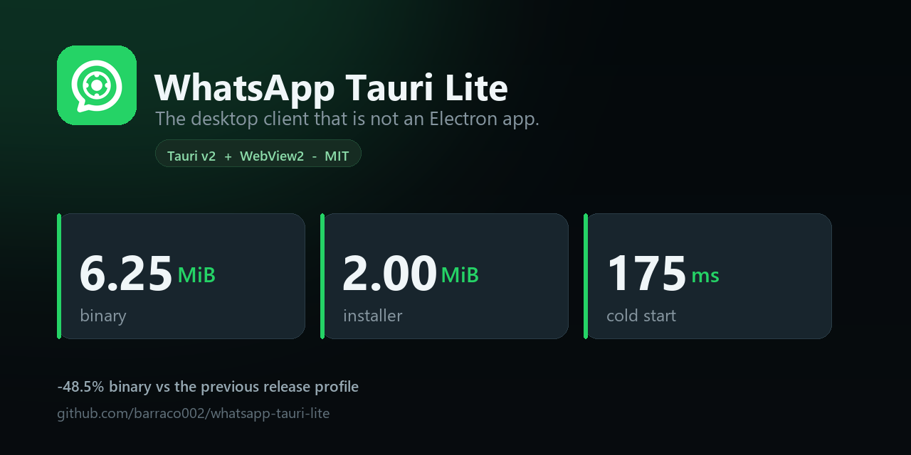

# WhatsApp Tauri Lite

**A WhatsApp desktop window in 6 MB, not 200.** Native window, the WebView your system already has, no bundled Chromium.

[](https://github.com/barraco002/whatsapp-tauri-lite/releases/latest)
[](https://github.com/barraco002/whatsapp-tauri-lite/stargazers)
[](LICENSE)
[](#installation)
[-brightgreen)](BENCHMARKS.md)



```
Typical Electron WhatsApp wrapper   ████████████████████████████████████████  ~200 MB
Discord                             ███████████████████████████████████████  ~180 MB
This app                            ████                                       6.25 MB
```

---

## Why this exists

Most WhatsApp desktop wrappers ship an entire Chromium build to render one web page. That is 180-200 MB of disk and
hundreds of megabytes of RAM for a chat window that never leaves `web.whatsapp.com`.

This one uses **Tauri v2** and the WebView the operating system already has (WebView2 on Windows). Nothing is bundled
but the window itself: the installer is **2.00 MiB**, the binary is **6.25 MiB**, and the window is visible **175 ms**
after launch.

The release profile in this build was tuned with measurements instead of vibes: fat LTO plus `codegen-units = 1` cut
the binary **48.5 %** with no measurable cost in startup, memory or frame pacing. The two variants that made it smaller
and were still rejected - `opt-level = "s"` and `"z"` - are documented with their numbers in
[BENCHMARKS.md](BENCHMARKS.md).

## What it is not

It is **not** a WhatsApp client. It is a window around WhatsApp Web: your messages still go through WhatsApp the same
way they do in a browser tab. There is no separate login, no protocol reimplementation, no proxy in the middle.

- No E2E implementation of its own. Whatever WhatsApp Web does, this does.
- No offline mode. It needs a connection, exactly like the web app.
- No Linux binaries published yet. The source is portable, but Releases currently carries the Windows installer only.
- An unofficial client. Not affiliated with WhatsApp or Meta. Use at your own risk.

## Features

- Native window and tray - no Chromium, no Electron runtime
- Global shortcut `Ctrl + Alt + W` to show/hide
- Optional auto-start with the system
- Native dark title bar and menus on Windows
- Downloads with sanitised filenames (reserved Windows names, duplicate handling)
- Deep links (`whatsapp://`), single-instance lock, native notifications

## Installation

**Windows** (Windows 10/11, WebView2 is preinstalled on both):

1. Grab `Whatsapp.Tauri_0.3.3_x64-setup.exe` from [**Releases**](https://github.com/barraco002/whatsapp-tauri-lite/releases/latest)
2. Run it. It installs for the current user - no admin prompt
3. Log in by scanning the QR with your phone, as usual

SHA-256 of the installer: `a389e6e7b8ad242f47412bef099735dceb8818398c1f3358d8ef8a389ca304c4`

```powershell
(Get-FileHash ".\Whatsapp.Tauri_0.3.3_x64-setup.exe" -Algorithm SHA256).Hash.ToLower()
# a389e6e7b8ad242f47412bef099735dceb8818398c1f3358d8ef8a389ca304c4
```

**Linux**: no binaries in Releases yet. Build from source (see below); the Tauri config targets WebKitGTK.

## Numbers (measured, not estimated)

| | value |
|---|---:|
| Installer (NSIS) | **2.00 MiB** |
| Binary | **6.25 MiB** |
| Cold start to visible window | **175 ms** (median of 10 runs) |
| Cold start to WebView ready | 692 ms |
| Idle RSS (including the WebView2 processes) | 845 MiB |
| Idle CPU | ~1 % |
| Frame pacing | 75 fps, p95 13.4 ms |

Same machine, same harness, raw dumps committed in [`perf/out/`](perf/out). Reproduce with `perf/measure.ps1`.
The caveats are written down, not hidden: the 845 MiB is 96 % WebView2 (the native process is 32 MiB), first paint is
network-bound and not a fair comparison, and "cold" means warm disk cache. See
[BENCHMARKS.md](BENCHMARKS.md#what-is-not-claimed-here).

## Building from source

Requirements: Rust + Cargo, Node.js, and on Windows the MSVC build tools and Windows SDK; on Linux, WebKit2GTK.

```bash
git clone https://github.com/barraco002/whatsapp-tauri-lite.git
cd whatsapp-tauri-lite/whatsapp-lite
npm install
npm run tauri dev      # development
npm run tauri build    # release binary + installer
```

## Project structure

```
whatsapp-lite/            # the Tauri app
  src-tauri/src/main.rs   # window, menus, downloads, deep links, tray
  src-tauri/Cargo.toml    # deps + the tuned [profile.release]
perf/                     # measurement harness, raw evidence, verification
BENCHMARKS.md             # what changed and what it cost
OPTIMIZATION_REPORT.md    # full audit: phases, KPIs, rejected variants
BUGS_FOUND.md             # pre-existing bugs, documented not fixed
```

## Credits and licence

MIT. Based on [Wpnnt/WhatsApp-Tauri](https://github.com/Wpnnt/WhatsApp-Tauri) - all credit for the original client goes
to its author. This repository adds the release-profile work, the measurement harness, hardening fixes from a source
audit, and a CI guard that fails any PR pushing the binary past 7 MB.

Not affiliated with WhatsApp or Meta. Unofficial client, use at your own risk.

---

If this saves you 200 MB of disk, a star costs nothing and helps other people find it.
